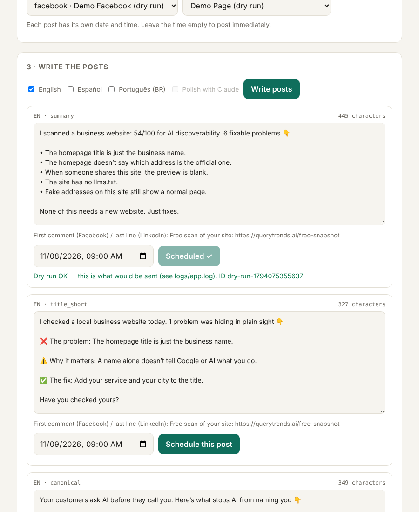

# QueryTrends X-Ray

**Scan a website for AI-discoverability problems, turn the findings into scroll-stopping social posts in English, Spanish and Brazilian Portuguese, and schedule them with the [Blotato API](https://www.blotato.com).**

Built by **Maria Myers** ([QueryTrends.ai](https://querytrends.ai) · MainEntry LLC), a trilingual medical & legal interpreter who builds with Claude Code.



## What it does

1. **Scan.** Enter any public website. The app runs 13 evidence-based checks for the signals Google and AI assistants use to find, understand and recommend a business: HTTPS, speed, title, description, canonical tag, share image, H1, structured data (schema), robots.txt (including whether ChatGPT/Claude/Perplexity crawlers are blocked), sitemap, `llms.txt`, real 404 pages, and www/non-www duplicates. Checks that can't run are marked *not checked*, never guessed.
2. **Write.** Each finding becomes a post built for the feed algorithm: a hook in the first line, short lines, problem → why → fix, and a question at the end to invite comments. Posts are **anonymized** (no business is named or shamed). Available in **EN / ES / PT-BR**, with optional polishing by Claude.
3. **Schedule.** Pick a connected Blotato account (Facebook Page, LinkedIn, X, Threads, Bluesky), set a date per post, and send. On Facebook the link goes in the **first comment**, because posts with outside links get less reach.
4. **Automate.** An included n8n workflow runs the whole thing every Monday.

## Run it (5 minutes)

Requires [Node.js 18+](https://nodejs.org). No packages to install.

```bash
git clone https://github.com/Mariavmyers/querytrends-social.git
cd querytrends-social
cp .env.example .env      # then paste your Blotato API key into .env
npm start                 # open http://localhost:3000
```

No API key? It runs in **DRY RUN** mode: everything works, and it shows the exact JSON it *would* send to Blotato, without posting.

```bash
npm test                  # 8 automated tests, no internet or key needed
```

## MCP servers used, and why

`.mcp.json` connects two MCP servers to Claude Code while building:

| MCP server | Why I added it |
|---|---|
| **Blotato MCP** (`mcp.blotato.com/mcp`) | Lets Claude Code list my real connected accounts and Pages and check post status while I debug, so I can compare what the API returns with what my code expects, without writing throwaway scripts. |
| **GitHub MCP** | Lets Claude Code create the repo, commit, and open issues/PRs from the same session, so the debug log and fixes are tracked as I go. |

Both read their keys from environment variables (`${BLOTATO_API_KEY}`, `${GITHUB_PERSONAL_ACCESS_TOKEN}`). No secrets are in the repo.

## How it's built

| File | Job |
|---|---|
| `server.js` | Small web server (Node built-ins only) and API routes |
| `lib/scanner.js` | The 13 discoverability checks, with private-network protection |
| `lib/posts.js` | Turns findings into algorithm-friendly posts in 3 languages, plus an optional Claude polish |
| `lib/blotato.js` | Blotato client: accounts, Pages, scheduling, status, retry on rate limit, plain-English errors |
| `lib/log.js` | Writes every event to `logs/app.log` with API keys redacted |
| `n8n/weekly-autopilot.json` | Import into n8n for a weekly automatic run via `POST /api/run` |
| `test/core.test.js` | Tests for the Blotato payload rules, robots.txt parsing, short posts, 3 languages |

**Blotato API calls used:** `GET /v2/users/me/accounts`, `GET /v2/users/me/accounts/{id}/subaccounts` (Facebook/LinkedIn Pages), `POST /v2/posts` (with top-level `scheduledTime`), `GET /v2/posts/{id}`.

## Debugging

Every API call is logged with its status and timing in `logs/app.log`. See **[DEBUG_LOG.md](DEBUG_LOG.md)** for the real bugs found while building this and how each was fixed: a soft-404 that faked a passing check, a scheduling field that would have published posts instantly, and more.

## n8n automation

1. In `.env`, set `RUN_TOKEN` to a long random password and restart the app.
2. In n8n: **Import from file** → `n8n/weekly-autopilot.json`.
3. Paste your run token, account ID and Page ID into the HTTP node.
4. If n8n runs in Docker, start the app with `HOST=0.0.0.0 npm start`.

## Limits (honest by design)

- The speed check measures server response only. Use Google PageSpeed for a full test.
- Scores show readiness signals; they don't prove rankings or AI citations.
- Text posts only. Instagram, TikTok, YouTube and Pinterest need media.

## License

MIT
